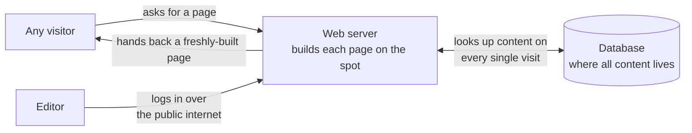
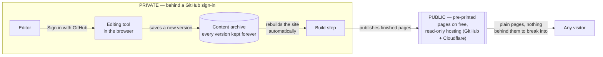

# Living on Earth — What We've Built and Why It Matters

A plain-English summary for the LOE team of what has been built and what it does.

---

## The Core Idea: Pages Built in Advance

The old website built each page when a visitor asked for it, like a press that prints only after you walk in. If any part of the machine broke, nobody got their page.

The new site builds every page ahead of time and leaves it on a shelf. There is no machine to break. Hosting is free: GitHub and Cloudflare provide the shelf space, and reliable file storage is their core business.

In practice, the site has no traffic spike, software failure, or missed bill to go down from.

---

## Two Pictures: How the Old Site and the New Site Are Built

A typical older website, which is what loe.org has historically been, is a program on an always-on machine that builds each page from a database on every visit.

One machine builds every page on demand, holds the keys to the database, and hosts the editor login, all reachable from the public internet. That is a lot to defend, patch, and keep running.

In the new site the editing side and the public side are separate, and the public side has no live machinery behind it:

Visitors only touch finished, read-only pages on file hosting. Editing happens elsewhere, behind a login, and never touches the public site directly.

### Why this is safer

- **No database or server sits behind the public site.** Visitors see plain files, so there is nothing to hack or overload.
- **The production site has no login page.** The old model put the editor login at the same public address as the site. On vibingon.earth there is no "admin" door.
- **Editors sign in with GitHub, so we never handle passwords.** GitHub does the password step, as the "Sign in with Google" button does elsewhere. Our site never sees or stores a password.
- **Only named people can get in.** An editor must also be on the project's approved list. Anyone else who signs in is turned away.
- **The worst case is small and reversible.** Someone who got into the editing side could only propose a content change. Every change is recorded, attributed to a person, reversible, and previewed before it reaches the public site.

| | Old site | New site |
|---|---|---|
| The public site is… | a live program talking to a database | a shelf of finished pages |
| If it's attacked or overloaded… | the whole site can go down | nothing to take down — files just sit there |
| The editor login is… | on the public site, open to the internet | separate and private, via "Sign in with GitHub" |
| Passwords are… | handled (and stored) by the site | never seen by the site — GitHub handles them |
| A bad or mistaken change is… | potentially live, and hard to undo | recorded, reversible, and previewed first |

---

## Thirty-Five Years in One Place

The rebuild includes the complete Living on Earth archive: more than 10,000 segments and 1,600 shows, going back to 1991. Every episode, transcript, and segment has a permanent address.

Older content used to exist without being reliably findable. Now it is indexed and connected, so a listener can find what LOE said about the Endangered Species Act in 1994.

---

## Editing: A Word Processor That Keeps Every Draft

Editors use a browser-based tool that works like a word processor, with no code or commands. You log in, see your stories, edit in a normal text interface, and save.

Every version of every story is kept permanently, so nothing can be deleted for good. An editor can see a story as it looked three months ago or undo last week's change. It works like "track changes" applied to every save.

---

## Preview Before Publishing

When an editor saves a story, a preview copy appears at a private address in about two minutes. It looks exactly as a listener would see it, audio player included. The story goes to the live site only after the editor approves.

---

## Topic Index

We defined a list of 90 topics, such as "climate policy," "biodiversity," "indigenous land rights," and "nuclear energy." An automated process then read the transcript of each of the 10,000+ segments in the archive and assigned it topics from that list.

The result is a topic index of everything LOE has covered since 1991. Each topic has a page listing every relevant segment, with a simple chart of how much LOE has covered it over time. A listener curious about ocean acidification can find every LOE segment on it, in order.

New segments are classified automatically when published.

---

## People Pages

Every person who appears in LOE transcripts (hosts, reporters, guests, scientists) has a page, built automatically from the transcripts. Nobody entered names into a form; the site worked out who appears and how often.

A listener can now find every story a particular reporter filed or hear more from a particular scientist.

---

## Automated Copy Review

Each time a story is published, an automated review runs in the background. It checks for typos and for mismatches between a guest's name in the text and in the headline, and flags anything else that looks off.

Editors save and publish as usual. Errors that used to slip through now get caught before readers see them.

---

## "This Week in LOE History"

The homepage has a section that surfaces archive content from the same week in previous years. It changes every week without anyone choosing the stories.

Longtime listeners get a reason to explore what they missed, and new listeners see how long the show has been running.

---

## The Practical Stuff

Smaller features:

- **Station finder by zip code** — type in a zip code, get the nearest affiliate and how far away it is
- **Reading time and listening time** shown on every segment, so a listener knows what they're getting into
- **Clickable moments in transcripts** — a listener can jump directly to a specific exchange in an episode
- **Chaptered audio** — a new show plays as one continuous episode with tappable chapter markers, so a listener can jump to a segment without loading a separate file for each
- **Dark mode** — the site follows the phone or computer setting, and you can switch manually
- **Works on any phone** — every page is readable on a small screen without zooming or scrolling sideways

---

## Summary

**The site won't break.** It is a shelf of pre-built pages with nothing live behind it.

**Editors get a safe workflow.** They write in a familiar tool, preview before publishing, keep every version, and have errors caught before they go out.

**Thirty-five years of work is findable.** The archive is indexed by topic, person, and date, and connected to current content.
